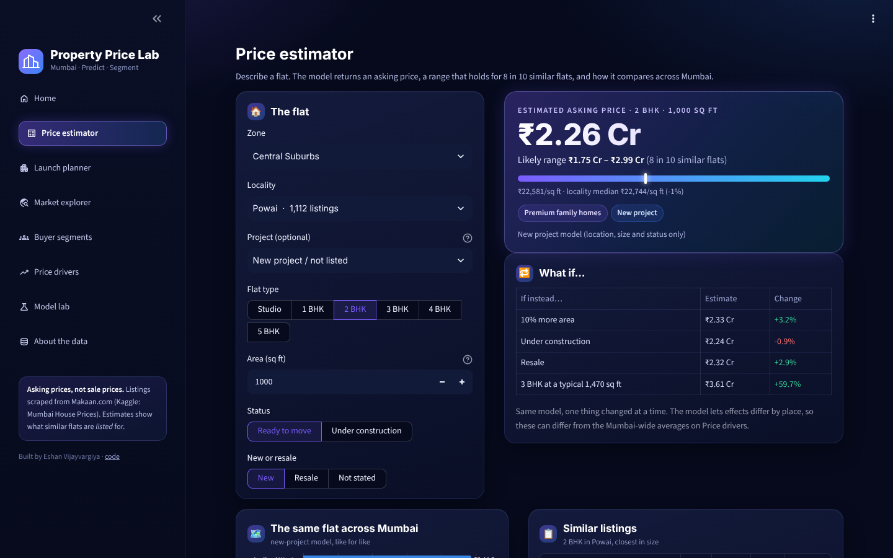
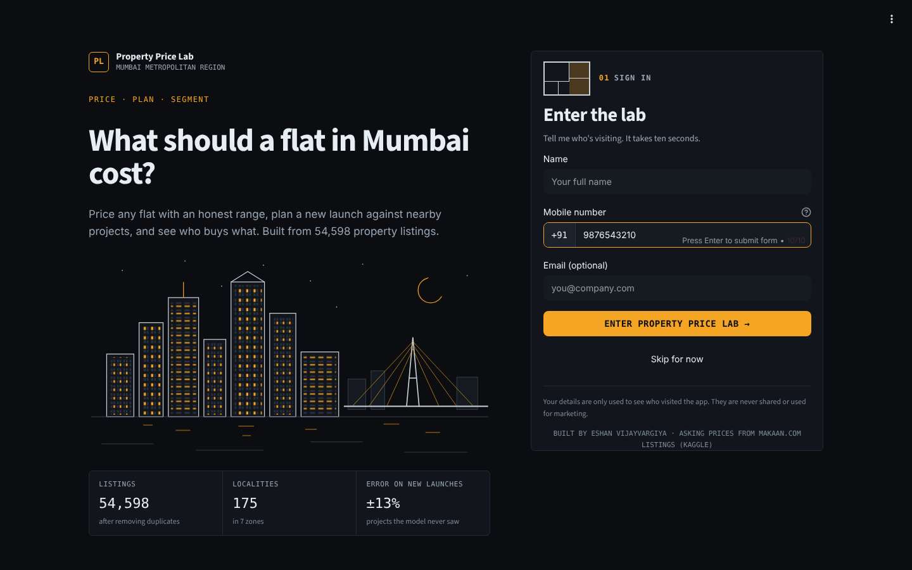

# Mumbai Property Price Lab

**What should a flat in Mumbai cost, what drives the price, and who buys what?**
A price model, a launch-pricing tool and buyer segments for the Mumbai Metropolitan Region, built from 54,598 cleaned
property listings and tested the way a developer would actually use it.

**Live app:** https://eshan-property-price.streamlit.app/



## What's inside

| Page | What it does |
|---|---|
| **Sign-in page** | Name, mobile number (+91 fixed, exactly 10 digits, must start 6-9) and an optional email, or *Skip for now*. Sign-ins go to a private Google Sheet and from there into an Excel file that refreshes (Power Query): [docs/SIGNIN_SETUP.md](docs/SIGNIN_SETUP.md) |
| **Price estimator** | Describe a flat (locality, project, BHK, area, status, new/resale): get an asking price, an 80% range (with the model's real past errors behind it), a floor plan that redraws with the flat type, the locality's own skyline and numbers, the same flat across Mumbai, what-ifs and similar listings |
| **Launch planner** | For a developer: price a new project's unit mix and see where it sits against the projects already selling in that locality |
| **Market explorer** | A locality price index (the same standard flat everywhere), zone profiles, a deep-dive on any locality |
| **Buyer segments** | K-Means on size and price per sq ft: five kinds of home and who each one suits |
| **Price drivers** | % effects from a fixed-effects regression, and what the model relies on |
| **Model lab** | Four models under three tests, predicted vs actual, error by zone, and whether the ranges hold |
| **About the data** | Source, every cleaning step, the zones, and why I rejected the first dataset |

## Data

[Mumbai House Prices](https://www.kaggle.com/datasets/dravidvaishnav/mumbai-house-prices) by Dravid Vaishnav (Kaggle):
76,038 listings scraped from Makaan.com with BHK, type, project, area, price, locality, construction status and
new/resale. These are **asking prices**, not registered sale values, from one snapshot (no dates). No licence is stated
on the Kaggle page; used here for learning, with credit. The CSV in `data/raw/` comes from a public GitHub mirror of
that Kaggle file.

**Cleaning** (`scripts/build_data.py`, every rule counted in `data/cleaning_report.json`):

| Rule | Removed |
|---|---|
| Exact duplicate listings (same flat posted again) | 20,312 (27%) |
| Villas, independent houses, penthouses (too few, different market) | 216 |
| More than 5 bedrooms | 116 |
| Area under 200 or over 6,000 sq ft | 62 |
| Price per sq ft in the extreme 0.5% at either end | 554 |
| Price per sq ft over 3x above or below its locality's typical value | 162 |
| Locality too small or unclear to place in a zone | 18 |
| **Clean listings** | **54,598** in 175 localities, 9,477 projects, 7 zones |

Duplicates matter most: left in, the same flat sits in both training and test data and the model looks better than it is.
Localities are mapped to 7 zones with whole-word rules after tidying spellings (`app/places.py`).

### The dataset I rejected first

*Housing Prices in Metropolitan Areas of India* (Kaggle) is often used for this. In every city it is two batches. Where
all amenities are coded 9 ("not mentioned"), area and bedrooms still agree (correlation ~0.8) but **price barely relates
to either (~0.2, against ~0.85 in the other batch)**: the price column looks misaligned with the rest of the row, for
about 70% of the data. A model trained on it learns noise. `scripts/check_six_city.py` reproduces this.

## Method

**Target:** log price (prices are skewed and errors are multiplicative).

**Features:** log area, area per bedroom, BHK, studio, under construction, new/resale, zone, and location values.
For location, each level gets a *typical log price per sq ft*, **shrunk towards the level above** when it has few
listings (project → locality → zone → Mumbai, an m-estimate). Training rows get these out of fold, so a listing never
sees its own price.

**Models:** a baseline (locality price per sq ft × area), linear regression with locality effects (ridge), random
forest, and gradient boosting (scikit-learn `HistGradientBoostingRegressor`) with a **monotonic constraint**: price can
only rise with area.

**Three tests** (5-fold cross-validation each), because a random split flatters the model when flats from one project
land on both sides:

| Model | Known project | New project | New locality |
|---|---|---|---|
| Baseline: locality ₹/sq ft × area | ±15.8% | ±16.2% | ±27.9% |
| Linear regression (locality effects) | ±13.6% | ±13.9% | ±25.8% |
| Random forest | **±8.4%** | **±12.5%** | ±27.2% |
| Gradient boosting (deployed) | ±9.2% | ±12.7% | **±25.1%** |

Median absolute % error. *Known project:* random folds, a new listing in a project already on the market.
*New project:* whole projects held out, pricing a launch the model has never seen (the developer's case).
*New locality:* whole localities held out, only the zone known.

- Within ±20%: 82% of flats for a known project, 69% for a new one (gradient boosting). R² on log price 0.957 / 0.925.
- **Why gradient boosting and not the forest:** the forest was 0.8 points better on known projects and 0.2 on new
  ones, but the file is 98 MB against under 2 MB per model. The monotonic constraint cost ~0.2 points; without it a
  1,000 sq ft flat could be priced below a 975 sq ft one.
- The app uses two boosting models: one trained with project values (when you pick a listed project) and one trained
  the way it's used for a launch, with whole projects held out.

**Price ranges:** the middle 80% of the model's own cross-validated errors, **one width per zone**, checked
cross-conformally (limits from 4 folds, coverage on the 5th). One width for all of Mumbai covered 80% overall but
only 66% of new-project flats in South Mumbai and 91% in Mira Road; per zone, every zone lands at 80%.
New-project ranges run from −17%/+19% (Mira Road) to −30%/+41% (South Mumbai).

**Price drivers:** OLS on log price with a fixed effect per locality (R² 0.92), standard errors clustered by project.

**Segments:** K-Means on standardised log area and log price per sq ft; k = 5 (silhouette is flat at 0.35-0.38 for
k = 3-7, so k was chosen for usefulness); five other random starts give the same segments (adjusted Rand 0.99).

## Findings

1. **Location is most of the price.** Median ₹31,200/sq ft in South Mumbai vs ₹5,900 in Kalyan-Dombivli: 5.3x.
2. **Location vs space is the buyer's choice.** About ₹0.9-1 crore buys ~550 sq ft in the western/central suburbs
   (*Compact city homes*) or ~1,090 sq ft in Navi Mumbai, Mira Road or Thane's edges (*Spacious value homes*).
3. **Bedrooms beat the area figure.** At the same stated area a 3 BHK lists 33% above a 2 BHK, while 10% more area
   adds only 5%. Listings mix carpet and built-up area, so the bedroom count is the cleaner size signal.
4. **No discount for waiting.** Under-construction flats list +1.8% vs ready ones in the same locality (95%: +0.6% to
   +3.1%); clearly positive only in Kalyan-Dombivli (+5.7%). Resale lists 3.9% below new.
5. **New launches are harder to price.** Knowing the project halves the error against the simple rule (16% → 9%); for
   a project the model has never seen it's ~13%. The rest is builder, floor, view and amenities, which the data lacks.

| Segment | Typical buyer | Price (middle half) | Size | Most typical in |
|---|---|---|---|---|
| Budget starter homes | First-time buyers | ₹33-58 L | 672 sq ft, 1 BHK | Neral, Badlapur, Karjat |
| Spacious value homes | Growing families | ₹84 L-1.3 Cr | 1,090 sq ft, 2 BHK | Kharghar, Kamothe, Kalamboli |
| Compact city homes | Young professionals | ₹71 L-1.14 Cr | 550 sq ft, 1 BHK | Vikhroli, Bhandup, Kurla |
| Premium family homes | Established professionals | ₹1.65-2.55 Cr | 970 sq ft, 2 BHK | Vile Parle, Santacruz, Andheri East |
| Large luxury homes | Senior executives, business owners | ₹2.85-5.75 Cr | 1,800 sq ft, 3 BHK | Worli, Prabhadevi, Lower Parel |

## Limits

Asking prices, not sales; one snapshot, so no trends; carpet and built-up area mixed; no floor, view, amenities,
parking or builder; big projects post many listings. The segments describe homes; the buyer labels are my reading.

## Design

A dark "terminal" look (IBM Plex Sans and Mono, one amber accent) chosen from four mock-ups. Every image is a line
drawing made in code (`app/art.py`): the city skyline, a skyline for each locality (taller towers where prices are
higher) and an illustrative floor plan. No photos, so nothing to license. Chart colours were checked for
colour-blind separation on the dark background.



## Run it

```bash
pip install -r requirements.txt
python -m streamlit run app/app.py
```

Rebuild everything from the raw CSV (about 5 minutes):

```bash
python scripts/build_data.py      # clean -> data/listings.parquet
python scripts/evaluate.py        # 4 models x 3 tests -> models/eval.json, data/oof.parquet
python scripts/train.py           # final models, ranges, drivers, importance, segments
python scripts/check_six_city.py  # the rejected dataset (downloads it)
python scripts/make_notebook.py   # notebooks/property_price_analysis.ipynb (needs requirements-notebook.txt)
```

## Project layout

```
app/        Streamlit app: app.py (router + sign-in gate), pg_*.py (pages), core.py (data, models, prices in ₹),
            art.py (skylines, floor plans), pg_login.py (sign-in),
            features.py (feature engineering, shared with training), places.py (localities -> zones), style.py, ui.py
scripts/    build_data, evaluate, train, check_six_city, make_notebook
data/       raw CSV, clean listings, locality index, cleaning report, cross-validated prediction sample
models/     price models, segments, eval / intervals / drivers / importance JSON
notebooks/  the analysis as a readable walkthrough
```

Built by Eshan Vijayvargiya · MBA (Data Science), Narayana Business School.
